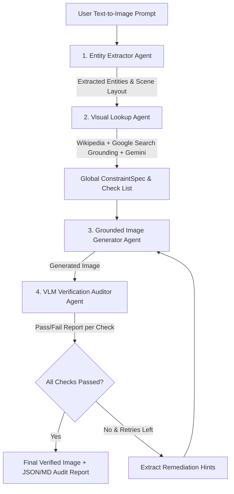

# Entity-Grounded Image Generation

A multi-agent text-to-image generation and verification system powered by **Google Gemini** and a multi-provider image backend. It decomposes user prompts into discrete entities, researches what each entity actually looks like in the real world, compiles a structured **Visual Constraint Specification (`ConstraintSpec`)**, guides image synthesis, and audits every output with a **Pass/Fail Verification Report** per check.

---

## Architecture Overview



### Core Agents & Modules

| Component | Module | Responsibility |
| :--- | :--- | :--- |
| **Entity Extractor Agent** | `src/agents/extractor.py` | Parses the prompt into discrete entities (`landmark`, `animal`, `artifact`, `vehicle`, `character`, etc.) and scene composition using Gemini Structured Outputs. |
| **Visual Lookup Agent** | `src/agents/lookup.py` | Queries external knowledge sources (Wikipedia REST API + built-in KB + Gemini with Google Search Grounding) to determine canonical visual traits, negative constraints, and verifiable check criteria. |
| **Image Generator Agent** | `src/agents/generator.py` | Compiles entity constraints and prior remediation hints into a grounded prompt, supporting native Gemini Image Generation as well as free-tier image providers (Pollinations FLUX / AI Horde fallback). |
| **Verification Auditor Agent** | `src/agents/verifier.py` | Uses Gemini Vision (VLM) to inspect the generated image check-by-check, producing a structured **PASS / FAIL** audit report with confidence scores, observed visual evidence, and remediation hints. |
| **Gemini Fallback Helper** | `src/gemini_helper.py` | Handles transient API spikes (`503` / `429` / `404`) with automatic exponential backoff retries and dynamic model discovery. |
| **Orchestrator** | `src/orchestrator.py` | Coordinates the 4-agent pipeline and manages the closed-loop self-correction cycle when any visual check fails. |

---

## Project Structure

```text
entity-grounded-image-generation/
├── main.py                  # CLI entrypoint with Rich terminal reporting
├── requirements.txt         # Python dependencies
├── .env.example             # Environment variable template
├── .gitignore               # Excludes .env, .venv/, outputs/, and cache files
├── src/
│   ├── __init__.py
│   ├── models.py            # Pydantic schemas (ConstraintSpec, VerificationReport, CheckVerdict)
│   ├── gemini_helper.py     # Auto-retry & dynamic model fallback for Gemini API
│   ├── orchestrator.py      # Multi-agent workflow & self-correction retry loop
│   └── agents/
│       ├── __init__.py
│       ├── extractor.py     # Prompt -> Entity decomposition
│       ├── lookup.py        # Entity -> Real-world visual lookup & ConstraintSpec
│       ├── generator.py     # ConstraintSpec -> Grounded image generation
│       └── verifier.py      # Generated image -> Pass/Fail VLM audit report
└── tests/
    └── test_pipeline.py     # End-to-end automated unit tests
```

---

## Installation

### 1. Prerequisites
- **Python 3.10+** (Python 3.9 works with warnings; 3.10+ recommended)
- A **Google Gemini API Key** (`GEMINI_API_KEY`) from [Google AI Studio](https://aistudio.google.com/) (optional if running in `--demo` mode)

### 2. Clone the Repository
```bash
git clone https://github.com/<your-username>/entity-grounded-image-generation.git
cd entity-grounded-image-generation
```

### 3. Create a Virtual Environment & Install Dependencies
```bash
python -m venv .venv

# On macOS / Linux:
source .venv/bin/activate

# On Windows (PowerShell):
.venv\Scripts\Activate.ps1

pip install -r requirements.txt
```

### 4. Configure Environment Variables
Copy `.env.example` to `.env` and add your Gemini API key:
```bash
cp .env.example .env
```

Edit `.env`:
```env
GEMINI_API_KEY=your-gemini-api-key-here
LLM_MODEL=gemini-3.8-flash
VLM_MODEL=gemini-3.8-flash
IMAGE_MODEL=flux
MAX_RETRIES=2
OUTPUT_DIR=outputs
```

> **Note on `IMAGE_MODEL`:** Setting `IMAGE_MODEL=flux` uses free-tier image providers (`Pollinations FLUX` with automatic `AI Horde` fallback) without requiring paid billing. If your Google AI Studio project has billing enabled, you can set `IMAGE_MODEL=gemini-3.1-flash-image` for native Gemini image synthesis.

---

## Usage

### 1. Run in Live Mode (with Gemini API Key)
```bash
python main.py --prompt "A Shiba Inu sitting in front of Wat Arun at sunset"
```

### 2. Run in Offline Demo Mode (No API Key Required)
Test the full multi-agent pipeline, constraint compilation, self-correction retry loop, and report generation offline:
```bash
python main.py --prompt "A Shiba Inu sitting in front of Wat Arun at sunset" --demo
```

### 3. CLI Options
```text
usage: main.py [-h] --prompt PROMPT [--max-retries MAX_RETRIES] [--output-dir OUTPUT_DIR] [--demo]

options:
  -h, --help            show this help message and exit
  --prompt, -p          Text-to-image query to ground, generate, and verify
  --max-retries         Maximum self-correction retries on check failure (default: 2)
  --output-dir          Directory to save images, specs, and reports (default: outputs)
  --demo                Run offline simulation without making external API calls
```

### 4. Programmatic Python Usage
```python
import os
from google import genai
from src.agents import (
    EntityExtractorAgent,
    VisualLookupAgent,
    ImageGeneratorAgent,
    VerificationAgent,
)
from src.orchestrator import EntityGroundedOrchestrator

client = genai.Client(api_key=os.environ["GEMINI_API_KEY"])

orchestrator = EntityGroundedOrchestrator(
    extractor=EntityExtractorAgent(llm_client=client, model="gemini-3.8-flash"),
    lookup=VisualLookupAgent(llm_client=client, model="gemini-3.8-flash"),
    generator=ImageGeneratorAgent(image_client=client, model="flux"),
    verifier=VerificationAgent(vlm_client=client, model="gemini-3.8-flash"),
    max_retries=2,
)

result = orchestrator.run("A Shiba Inu sitting in front of Wat Arun at sunset")

print("Overall Passed:", result.final_report.overall_passed)
print("Final Image:", result.final_image_path)
print(result.final_report.to_markdown())
```

---

## Output Artifacts & Pass/Fail Report

Every execution creates a timestamped run directory inside `outputs/<run_id>/`:

- `01_entities.json` — Extracted entities and scene layout
- `02_constraint_spec.json` — Grounded visual features, negative constraints, and check definitions
- `grounded_prompt_attempt_<n>.txt` — Exact constraint-enriched prompt sent to the generator
- `image_attempt_<n>.png` — Generated image for attempt `n`
- `verification_report_attempt_<n>.json` — Machine-readable check verdicts
- `verification_report_attempt_<n>.md` — Human-readable Pass/Fail audit report

### Example Pass/Fail Report (`verification_report_attempt_1.md`)

```markdown
# Verification Report (Attempt 1) — [FAIL]

- **Image:** `outputs/20261120_133839/image_attempt_1.png`
- **Overall Status:** **FAIL**
- **Pass Rate:** 44.4% (4/9 checks)
- **Summary:** The image partially aligns on sunset lighting and basic ear and coat markings, but lacks anatomical canine precision and detailed Wat Arun architecture.

## Check-by-Check Breakdown

| Check ID | Entity | Criterion | Status | Confidence | Observed Evidence |
| :--- | :--- | :--- | :---: | :---: | :--- |
| `shiba_inu_check_1` | `shiba_inu` | Upright triangular prick ears slightly tilted forward | **PASS** | 0.68 | Upright triangular ears are visible on the subject's head. |
| `shiba_inu_check_2` | `shiba_inu` | Cream-white urajiro markings on cheeks, muzzle, chest, and underside | **PASS** | 0.66 | Lighter fur patterns appear across the chest, muzzle, and cheeks. |
| `shiba_inu_check_3` | `shiba_inu` | Thick double coat (red-sesame, black-and-tan, or cream) with a tightly curled sickle tail | **FAIL** | 0.65 | Coat appears smooth and synthetic, and the tail lacks a curled sickle posture. |
| `wat_arun_check_1` | `wat_arun` | Tall central Khmer-style prang tower rising sharply with tiered ornamentation | **PASS** | 0.62 | A tiered Khmer-style spire appears softly focused in the distant background. |
| `wat_arun_check_2` | `wat_arun` | Off-white / cream stucco surface inlaid with intricate floral mosaics of colorful Chinese porcelain | **FAIL** | 0.68 | Background blur obscures detailed ceramic and porcelain mosaic textures. |
| `global_coherence` | `global` | Lighting, perspective, and scale between all entities are visually coherent | **PASS** | 0.67 | Warm sunset light and ground perspective are consistent across elements. |

## Remediation Hints

- **`shiba_inu_check_3` (shiba_inu):** Prompt for a distinct, tightly curled tail and natural double coat.
- **`wat_arun_check_2` (wat_arun):** Prompt for sharper background detailing showing porcelain mosaic patterns.
```

---

## Running Tests

```bash
python -m unittest discover -s tests -v
```

---

## License

MIT License
