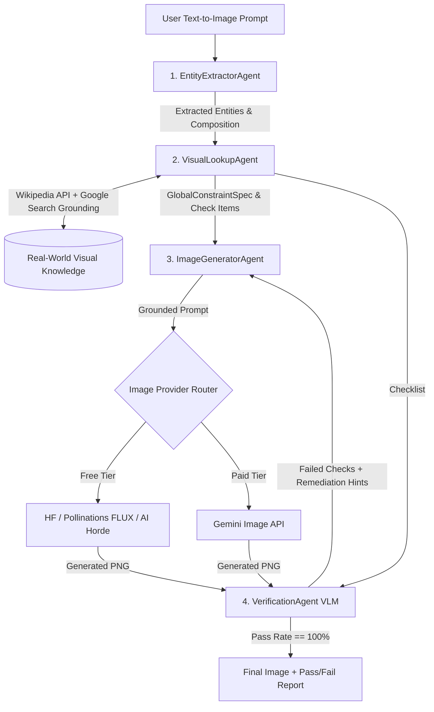

# Entity-Grounded Image Generation

A Multi-Agent System that decomposes a text-to-image query into distinct visual entities, researches what each entity actually looks like in the real world, compiles a structured **Visual Constraint Specification**, guides image generation, and automatically audits the resulting image using a Vision-Language Model (VLM) to produce a detailed **Pass/Fail Report** with self-correction retries.

---

## 🎯 Project Objective

Standard text-to-image models frequently hallucinate architectural, anatomical, or cultural details of specific landmarks, species, and objects. This project enforces factual visual grounding through a 4-stage multi-agent pipeline:

1. **Entity Decomposition (`EntityExtractorAgent`)**: Parses the user prompt into discrete entities (landmarks, animals, objects, characters) and global scene composition requirements.
2. **Visual Knowledge Lookup (`VisualLookupAgent`)**: Queries Wikipedia REST API and Google Search Grounding via Gemini to compile an atomic `GlobalConstraintSpec` containing observable visual traits, negative constraints, and verifiable check items.
3. **Constraint-Guided Image Generation (`ImageGeneratorAgent`)**: Synthesizes entity constraints and prior failure remediation hints into a grounded prompt, supporting both **Free Tier Multi-Provider Routing** (`Hugging Face` → `Pollinations FLUX` → `AI Horde`) and **Paid Native Gemini Image Generation** (`gemini-3.1-flash-image`).
4. **Automated VLM Verification & Self-Correction (`VerificationAgent` + `EntityGroundedOrchestrator`)**: Uses Gemini Multimodal Vision to inspect the generated image against every check item, outputs structured `.md` and `.json` **Pass/Fail Reports**, and feeds `remediation_hints` back into the generator if any check fails.

---

## 🏗️ System Architecture



---

## 📁 Project Structure

```text
entity-grounded-image-generation/
├── main.py                       # CLI entry point with Rich terminal reporting
├── requirements.txt              # Python dependencies
├── .env.example                  # Environment variable template
├── .gitignore                    # Excludes .env, .venv/, outputs/, and cache files
├── README.md                     # Project documentation
├── src/
│   ├── __init__.py
│   ├── models.py                 # Pydantic schemas (ConstraintSpec, VerificationReport, CheckVerdict)
│   ├── gemini_helper.py          # Auto-retry & dynamic model fallback for 503/429/404 errors
│   ├── orchestrator.py           # Multi-agent coordinator & self-correction retry loop
│   └── agents/
│       ├── __init__.py
│       ├── extractor.py          # Agent 1: Prompt-to-entity parser
│       ├── lookup.py             # Agent 2: Visual knowledge & constraint builder
│       ├── generator.py          # Agent 3: Multi-provider grounded image generator
│       └── verifier.py           # Agent 4: Multimodal VLM Pass/Fail auditor
├── tests/
│   └── test_pipeline.py          # End-to-end pipeline unit tests
└── outputs/                      # Timestamped run folders (images, specs, and reports)
```

---

## ⚙️ Installation

### 1. Prerequisites
- **Python 3.10** or higher recommended
- A **Google Gemini API Key** from [Google AI Studio](https://aistudio.google.com/) (Free Tier works out of the box for all LLM & VLM agents)
- *(Optional)* A **Hugging Face Token** (`hf_...`) from [Hugging Face Settings](https://huggingface.co/settings/tokens) for serverless image inference

### 2. Clone the Repository
```bash
git clone https://github.com/your-username/entity-grounded-image-generation.git
cd entity-grounded-image-generation
```

### 3. Create a Virtual Environment & Install Dependencies
```bash
python3 -m venv .venv

# On macOS / Linux:
source .venv/bin/activate

# On Windows:
.venv\Scripts\activate

pip install -r requirements.txt
```

---

## 🔐 Environment Configuration (`.env`)

Copy `.env.example` to `.env`:
```bash
cp .env.example .env
```

Edit `.env` according to your preferred setup:

```env
# 1. Google Gemini API Key (Required for live Entity Extraction, Lookup & VLM Verification)
GEMINI_API_KEY=your_gemini_api_key_here

# 2. Optional Free Image Generation Providers (used when IMAGE_MODEL is not a 'gemini-*' model)
HF_TOKEN=hf_your_huggingface_token_here
AI_HORDE_API_KEY=0000000000

# 3. Model Selection
LLM_MODEL=gemini-3.8-flash
VLM_MODEL=gemini-3.8-flash
IMAGE_MODEL=flux

# 4. Pipeline Defaults
MAX_RETRIES=2
OUTPUT_DIR=outputs
```

### Environment Variables Reference

| Variable | Description | Default |
| :--- | :--- | :--- |
| `GEMINI_API_KEY` | Google AI Studio API key used by `EntityExtractorAgent`, `VisualLookupAgent`, and `VerificationAgent`. If omitted, the pipeline automatically falls back to offline `--demo` mode. | — |
| `HF_TOKEN` | *(Optional)* Hugging Face access token for serverless `hf-inference` image generation before falling back to Pollinations or AI Horde. | — |
| `AI_HORDE_API_KEY` | *(Optional)* API key for the free volunteer GPU cluster on AI Horde (`0000000000` works anonymously without registration). | `0000000000` |
| `LLM_MODEL` | Gemini model used for entity extraction and constraint synthesis. Includes automatic retry/fallback via `src/gemini_helper.py` if `503`/`404` occurs. | `gemini-3.8-flash` |
| `VLM_MODEL` | Multimodal Gemini model used to visually audit generated images against each constraint. | `gemini-3.8-flash` |
| `IMAGE_MODEL` | Set to `flux` (free multi-provider cascade: HF → Pollinations FLUX → AI Horde) or `gemini-3.1-flash-image` (requires Google Cloud Billing enabled on your Gemini API project). | `flux` |
| `MAX_RETRIES` | Maximum self-correction regeneration attempts when any visual check fails (`pass_rate < 1.0`). | `2` |
| `OUTPUT_DIR` | Root directory where timestamped run artifacts are saved. | `outputs` |

---

## 🚀 Usage

### 1. Live Mode (Real Image Generation + Gemini VLM Audit)
```bash
python main.py --prompt "A Shiba Inu sitting in front of Wat Arun at sunset"
```

### 2. Offline Demo Mode (No API Quota Required)
Test the full multi-agent orchestration, constraint compilation, simulated failure, and remediation retry loop offline:
```bash
python main.py --prompt "A Shiba Inu sitting in front of Wat Arun at sunset" --demo
```

### 3. CLI Options
```bash
python main.py \
  --prompt "A red panda wearing a blue scarf in front of the Eiffel Tower" \
  --max-retries 2 \
  --output-dir outputs
```

| Flag | Description | Default |
| :--- | :--- | :--- |
| `--prompt` | **(Required)** Text-to-image query to decompose, ground, generate, and verify. | — |
| `--demo` | Force offline demo mode (renders diagnostic spec cards instead of calling live APIs). | `False` |
| `--max-retries` | Number of self-correction regeneration loops if any visual check fails. | `MAX_RETRIES` (`2`) |
| `--output-dir` | Directory where timestamped run folders are created. | `OUTPUT_DIR` (`outputs`) |

### 4. Run Unit Tests
```bash
pytest
```

---

## 📊 Output Artifacts & Pass/Fail Report

Each execution saves a complete audit trail under `outputs/<YYYYMMDD_HHMMSS>/`:

- `01_entities.json` — Parsed entities, categories, and scene composition
- `02_constraint_spec.json` — Researched visual profiles, negative constraints, and atomic check items
- `grounded_prompt_attempt_<N>.txt` — Exact constraint-grounded prompt sent to the generator on attempt `N`
- `image_attempt_<N>.png` — Generated image for attempt `N`
- `verification_report_attempt_<N>.md` — Human-readable Pass/Fail audit table and remediation hints
- `verification_report_attempt_<N>.json` — Machine-readable verification verdicts and confidence scores

### Example Verification Report (`verification_report_attempt_1.md`)

| Check ID | Entity | Criterion | Status | Confidence | Observed Evidence |
| :--- | :--- | :--- | :---: | :---: | :--- |
| `shiba_inu_check_1` | `shiba_inu` | Upright triangular prick ears slightly tilted forward | **PASS** | 0.90 | The dog has upright triangular prick ears slightly tilted forward. |
| `shiba_inu_check_2` | `shiba_inu` | Cream-white urajiro markings on cheeks, muzzle, chest, and underside | **PASS** | 0.95 | Distinct cream-white urajiro markings appear on the cheeks, muzzle, and chest. |
| `shiba_inu_check_3` | `shiba_inu` | Thick double coat with a tightly curled sickle tail | **FAIL** | 0.85 | Tail lies extended rather than tightly curled over the back. |
| `wat_arun_check_1` | `wat_arun` | Tall central Khmer-style prang tower rising sharply with tiered ornamentation | **PASS** | 0.88 | Central tiered Khmer-style spire rises prominently in the background. |
| `wat_arun_check_2` | `wat_arun` | Off-white stucco surface inlaid with colorful Chinese porcelain floral mosaics | **FAIL** | 0.80 | Temple surface is heavily shadowed, obscuring porcelain mosaic details. |
| `global_coherence` | `global` | Lighting, perspective, and scale between all entities are visually coherent | **PASS** | 0.85 | Foreground dog scale and sunset perspective align consistently. |

When a check fails, `VerificationAgent` automatically generates `remediation_hints` (e.g., *"Regenerate with a tightly curled sickle tail resting on its back"*) and triggers `Attempt 2` to fix the missing visual traits.